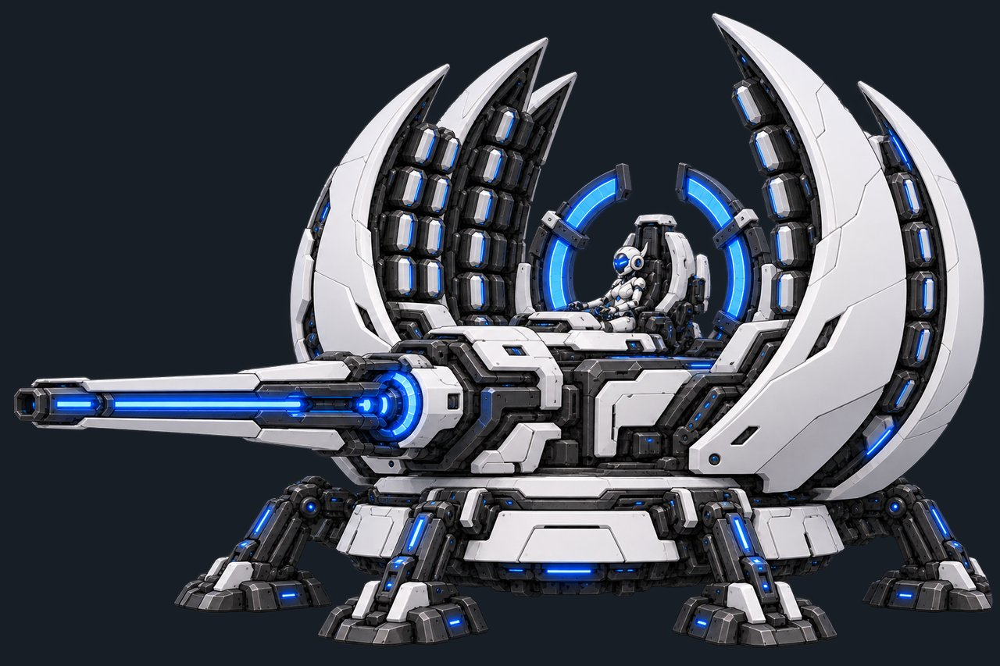
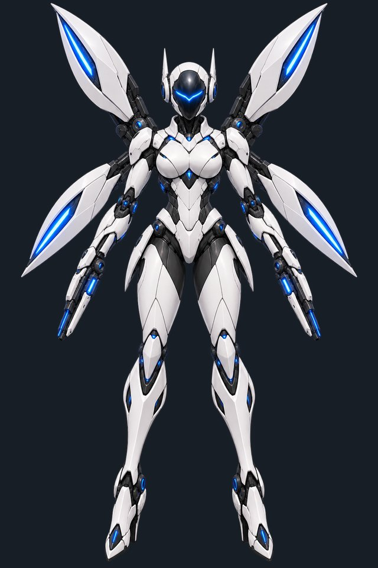
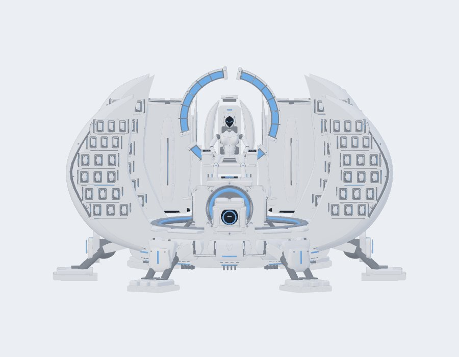

<!-- Generated by scripts/github_readme.ps1 from media/README.template.md, package/README.md and package/CHANGELOG.md. Edit those instead. -->

<h1 align="center">Ivory Bastion</h1>

A flying survivor for Risk of Rain 2 with a missile fortress, specialized drones and upgrades that last the run. 
<a href="https://github.com/Kuriyukihime/IvoryBastion/releases/latest"><b>Download the latest release</b></a> · <a href="#installation-and-settings">Install</a> · <a href="#changelog">Changelog</a>

| Mobile form | Siege form, in-game model |
|---|---|
|  |  |

Concept art (top and left) and a render of the in-game siege model made outside the game (right).

## About

A flying survivor who transforms into an immobile missile fortress. Harass enemies from the air, replenish ammunition, then deploy a mechanical throne armed with lasers, drones and sky-diving warheads.

White armor, black panels and blue accents accompany animated transformations, mechanical audio, AI dialogue and a resource HUD.

Read the [player wiki](https://thunderstore.io/c/riskofrain2/p/Kuriyukihime/IvoryBastion/wiki/) for detailed stats, upgrades and item interactions.

## Controls and abilities

| Input | Mobile form | Siege form |
|---|---|---|
| Primary | **Needlefire:** rapid, aim-assisted shots that replenish siege ammunition on hit. | **Ion Lance:** tap for an automatically targeted, piercing beam with an 8m impact blast. Hold for the **Missile Battery**: aim at an enemy to focus it, or aim at empty space to attack the nearest reachable enemy. |
| Secondary | **Thruster Boost:** hold to accelerate using a recharging fuel reserve. | **Aegis Protocol:** barrier, healing, damage reduction, faster missile reload and a temporary Bulwark. |
| Shift | **Heavenfall Rush:** a 15m dash firing 32 homing micro-missiles. Two charges, 10s recharge each. | **Widow Array:** deploy 24 spider mines in three rings around the fortress. |
| R | **Blue Shift:** increased attack speed, flight speed and fuel recovery for eight seconds. | **Skyfall Barrage:** ten sky-diving warheads, each dealing 500% damage in a 15m blast radius. |
| C | Deploy into siege mode near solid ground. | Pack into mobile form. |
| V | View Engineering. | Buy upgrades and change drone loadouts. |

Move toward your aim to fly, press Space to rise, and release movement to hover. Boost provides three seconds of acceleration; Blue Shift extends attack runs. Transformation has a six-second cooldown and requires solid ground within six metres to deploy. Transform and Engineering bindings are configurable.

## Make every missile count

The Missile Battery holds **30 missiles**, or **45 with its capacity upgrade**. Normal missiles have a 5m blast radius; every eighth shot is a heavy missile with a 10m blast. Both lock onto the enemy under or near your crosshair, or select the nearest reachable enemy when none is close. Deploy for faster reloads; Needlefire hits also replenish missiles. Ion Lance recharges in five seconds. Skyfall uses separate ammunition.

Needlefire's blue reticle marks a visible enemy within a **6° cone** and **45m**. Aim assist guides shots toward it; without a lock, shots follow your aim.

Skyfall prioritizes clusters, then bosses, elites and isolated enemies. Its warheads spread their coverage, overlapping when fewer targets remain. Heavenfall Rush spreads missiles across nearby enemies in any direction, prioritizing your attached spider mines. Splash counts toward covering groups before more missiles are assigned, letting you concentrate on flying.

**Widow combo:** spiders detect enemies within 30m, crawl up to 50m, attach and wait. Hit a marked enemy with your missile, Ion Lance, Heavenfall Rush or Skyfall to trigger an electrical explosion and slow. Mines never detonate themselves or each other. Attachment caps rise for elites and bosses. Mines last a minute after landing; reaching the active limit harmlessly replaces older deployments.

## Build your fortress

Earn **Fabrication while deployed**, with higher production during combat and additional income from nearby kills. Spend it in Engineering on **Siege, shared Defense and Mobile** paths. Purchases persist through stages and revival, so your choices shape the whole run.

Specialize in missiles, lasers, mines, drones or mobile combat. Ranked paths have prerequisites, increasing costs and distinct mastery effects. Shared Defense strengthens both forms; Engineering shows each rank, requirement and bonus.

**Single player pauses while Engineering is open. Multiplayer keeps running.**

Choose **Bulwark** for crowd control, **Gunner** for sustained damage, **Interceptor** for projectile defense or **Repairer** for healing. Unlock additional drone options and tailor your deployed support to your build.

## Stay protected

**Seraph Shield** scales with maximum health and reduces damage to its charge by 40%. It recharges after seven seconds without shield damage in mobile form, or four in siege form. **Aegis Barrier** sits above it, adding temporary protection while allowing a covered shield to recover. Separate slim gauges above health show both resources, with shield-break and recharge audio cues.

## Installation and settings

Requires **BepInExPack, RoR2BepInExPack, HookGenPatcher, Risk of Options**, and **R2API Core, ContentManagement, Prefab, Language, RecalculateStats and Networking**. Install these first; any Risk of Rain 2 mod manager can install them.

Then download `IvoryBastion-x.y.z.zip` from the [latest release](https://github.com/Kuriyukihime/IvoryBastion/releases/latest) and import it in your mod manager (in r2modman: Settings → Import local mod), or copy its `BepInEx` folder into your Risk of Rain 2 folder. Everyone in multiplayer needs the same version. To hear about new versions, click **Watch → Custom → Releases** on the GitHub page.

Open **Settings → Mod Options → Ivory Bastion** for controls, HUD, local audio and host balance settings. Gameplay settings apply next run; audio, HUD and controls update immediately. The master audio switch also mutes other players' Ivory Bastion sounds locally.

Use **Reset Settings → Reset All to Defaults** to restore the mod's current defaults; confirmation is required.

## Audio credits

Transformation Foley uses edited CC0 recordings by [qubodup](https://freesound.org/people/qubodup/sounds/871231/), [Jedimichael](https://freesound.org/people/Jedimichael/sounds/83887/) and [BMacZero / Brian MacIntosh](https://opengameart.org/content/mechanical-sounds).

## Changelog

### 1.6.0

- **Ivory Bastion has moved to GitHub.** This is the last update posted on Thunderstore. New versions will be at github.com/Kuriyukihime/IvoryBastion/releases.
  - To get notified, click **Watch → Custom → Releases** on that page.
  - To install a new version, import its ZIP in your mod manager (r2modman: Settings → Import local mod).
- No gameplay changes.

Earlier versions

### 1.5.0

- **Missile Battery:** manual aim is far more forgiving. Missiles now lock onto the enemy closest to your crosshair within **15 degrees**, instead of requiring the crosshair to sit exactly on its body. With no enemy that close, they still target the nearest reachable enemy.

### 1.4.0

- **Lighter siege form:** reduced the fortress model's close-range polygon count by about **54%**, with extra detail retained in the cannon, halo and pilot. Optimized its animation rendering while preserving the existing textures and moving parts. The mobile model is unchanged.

### 1.3.0

- **Missile Battery:** aim directly at an enemy to focus it. With no enemy under your crosshair, normal and heavy missiles target the nearest reachable enemy instead.
- **Heavenfall Rush:** splits its salvo across nearby enemies, prioritizing your attached spider mines. Splash coverage helps the remaining missiles spread through the crowd.
- **Widow Array:** spider mines detect enemies from **30m** away (up from 16m) and can crawl **50m** in total (up from 20m). Existing defaults update once; custom settings are preserved.

### 1.2.3

- **Faster Fabrication:** deployed production rises from **14 to 17 FAB/min idle** and **35 to 42 FAB/min in combat**—a 20% increase, with idle rounded upward to keep whole-number rates. Upgrade prices and kill rewards are unchanged.
- Existing default rates update once; custom rates are preserved. Changes apply when the next run starts.
- **Fixed:** an error that repeated every frame on the character-select screen and during runs, flooding the BepInEx log. The Widow Array launcher hatches now open while mines deploy, as intended.
- **Mine performance:** large Widow Array fields create far less temporary memory each frame, reducing stutter. Mine behavior and damage are unchanged.
- Finished mines no longer send a stale state update if their target dies during a leap.

### 1.2.2

A balance and performance update for Ivory Bastion, with more forgiving mobile aim assist and a new player wiki.

#### Combat balance

- **Base damage:** 12 → **10**, with level growth reduced from 2.4 to **2**. This lowers raw kit damage by roughly **17% at every level**, including upgraded weapons. Damage percentages, fire rates, missile counts, cooldowns and explosion sizes retain their existing values.
- **Gunners:** bullet damage reduced from 70% to **60%**. Combined with the base-damage change, one Gunner now deals about **15 DPS instead of 21** at level one before items, armor or critical hits. This softens the early damage spike from additional Gunners.
- **Item scaling:** supported native on-hit effects still work, with lower proc coefficients to reduce how quickly overlapping explosions amplify item builds. A coefficient scales applicable item chances; it is not itself a percentage chance.

| Attack | Previous coefficient | New coefficient |
| --- | --- | --- |
| Needlefire | 0.6 | **0.5** |
| Normal missile | 0.6 | **0.4** |
| Heavy missile | 1.0 | **0.6** |
| Ion Lance | 1.0 | **0.7** |
| Skyfall warhead | 1.0 | **0.4** |
| Heavenfall micro-missile | 0.15 | **0.1** |
| Widow detonation | 0.5 | **0.2** |
| Drone bullet | 0.5 | **0.35** |

Blue Shift's purchased ricochet remains **0.3**. Drone bullets check their own inventory.

#### Shields

- **Seraph Shield:** damage reduction reduced from 50% to **40% in both forms**.
- **Hardening:** its flat shield-reduction bonus scales from 5 to **4 points**, giving **44%** at maximum rank while preserving its relative bonus.
- **Aegis stacking:** Aegis's own 35% base / 40% hardened reduction is unchanged. Combined siege protection with charged Seraph is now **61% base / 66.4% fully hardened**, down from 67.5% / 73%.
- Shield capacity, recharge delays, Aegis barrier and healing remain unchanged. Other Engineering bonuses, prices, prerequisites and masteries are preserved.

#### Handling, performance and documentation

- **Needlefire aim assist:** widened from 4° to **6°**, retaining the blue reticle, **45m** range, crosshair priority and terrain visibility checks.
- **Combat performance:** reduced repeated mesh loading and temporary allocations when spawning cached mines/drones. Shield and Aegis effects perform less repeated CPU work while retaining their detail, ripples and appearance.
- **New player wiki:** guides for both forms, every Engineering rank and mastery, drones, defenses, item interactions, settings and multiplayer. Find it through the Wiki tab or the description's link.
- **Existing settings:** former defaults update once; custom values and later deliberate choices are preserved. Balance changes apply next run. Everyone in multiplayer should update to the same version.

### 1.1.2

- **Needlefire aim assist:** a blue reticle marks the visible enemy closest to your crosshair within 4° and 45m. Shots adjust toward the marked target, or fire normally without a lock. Damage and fire rate are unchanged.
- **More responsive transformation:** switch forms while moving, sprinting, boosting or holding attacks. Custom bindings still respect their required modifiers.
- **Faster spider mines:** walking speed increased from 5 to **6m/s**. Custom speed settings are preserved.
- **Engineering is easier to find:** Autonomous Foundry now highlights **V (default)**, Fabrication income and upgrades that last the run.
- **Clearer skill descriptions:** shortened crowded ability summaries and moved detailed Engineering, shield and weapon explanations into the native right-side keyword popups.
- **Reset All to Defaults:** added a confirmed reset in Mod Options. Audio, HUD and controls reset immediately; balance resets apply next run.

### 1.0.2

- Expanded the public description and release overview with more gameplay detail. Gameplay and assets are unchanged.

### 1.0.1

- Shortened the Thunderstore description and release notes. Gameplay is identical to 1.0.0.

### 1.0.0

#### New abilities and combat options

- **Transformation moves to C**, freeing Shift for a dedicated ability in each form. Its binding and shared cooldown are shown on the HUD; both transformation and Engineering keys are configurable.
- **Heavenfall Rush:** dash 15m while launching 32 homing micro-missiles with splash damage. Two charges recharge individually over 10 seconds. Automatic targeting, short recovery and retargeting after kills keep the attack moving through a group.
- **Widow Array:** deploy 24 spider mines in three rings. Spiders seek nearby enemies, attach to their models and wait for your attack. Mines last up to a minute after landing, allowing time to prepare a position.
- **Mine combo:** hit a marked enemy with your missiles, Ion Lance, Heavenfall Rush or Skyfall to trigger a charged electrical blast and slow. Mines never detonate autonomously or set off other mines; an actual hit on the marked enemy is required.

#### Engineering rebuilt

- Reorganized progression into **Siege / shared Defense / Mobile**. Choose focused paths for weapons, drones, protection or flight instead of receiving broad bonuses to everything. Heavenfall Rush belongs to Mobile; Defense strengthens both forms.
- Upgrades now have multiple ranks, prerequisites and distinct mastery bonuses at maximum rank. Early investments are cheaper, while advanced paths require more Fabrication. The menu displays costs, requirements and full effects so you can plan your next purchase.
- **Engineering pauses single player**, including while you purchase upgrades. Closing it restores normal play without interfering with the game's pause menu. **Multiplayer remains live.** Upgrades and drone loadouts persist through stages and revival.

#### Balance and mine behavior

- Reduced damage across the expanded arsenal: Needlefire now deals **80% per shot**, normal missiles **100%**, heavy missiles **300%**, and Ion Lance **700%** before upgrades. Skyfall deals **500% per warhead**, and missile capacity is **30 / 45 upgraded**. Gunner damage was also reduced.
- Mines deal **90% damage in an 8m radius** before upgrades. Shared attachment limits are **five per normal enemy, eight per elite and twelve per boss**, encouraging spare spiders to find other targets. Leaping spiders reserve their slots to prevent overcrowding.
- Improved crawling and latching on moving targets, slopes and small steps. Excess spiders retarget or wait. Expired or replaced mines disappear harmlessly, and other players' attacks do not trigger your marks.

#### Reliability and presentation

- Each form's new skill has its own charges. Extra-stock items work with both, recharge progress survives upgrades, and transformation does not refill them. Already accepted Rush volleys retain their timing and payload through later purchases.
- Improved multiplayer synchronization for progression and shared mine attachment limits. Added Mod Options settings for the new abilities, controls and dialogue timing while preserving existing custom balance choices.
- Added utility animations, integrated mine launchers, articulated spiders, blue attachment markers and white electrical detonations. Mine explosions have dedicated sound, anticipation and HUD feedback.
- Transformation now unfolds in stages with recorded mechanical Foley. Survivor selection faces forward, uses a smaller frame and transforms into siege mode. The original mobile launcher portrait returns.
- New skill callouts share voice cooldowns and overlap prevention with existing dialogue. Rewrote skill descriptions, fixed missing language tokens and clarified controls, timing and mine interactions; detailed upgrade effects stay in Engineering.

### 0.33.0

- **Seraph gets a visual polish pass.** More detailed armor, helmet and missile doors, refreshed portraits, and cannon cooling fins that open after firing.
- **Flight and weapons feel more responsive.** Stronger acceleration and braking poses, a clearer Blue Shift wind-up and wing release, and recoil from the missile bank that actually fires.
- **A smoother HUD.** The slant stays, with smoother panel edges, bars and shield hexagons. Icons stay clearer when scaled, and you can resize the combat and fabrication panels in Mod Options.
- **Easier-to-read defenses.** Shield and Aegis bars briefly show recent damage, mark recharge and fortification, and display Aegis's remaining time.
- **Cleaner combat effects.** Softer Ion Lance glow, flowing Blue Shift energy ribbons and less smoke obscuring overlapping missile blasts.
- **Clearer audio, more control.** Dialogue and shield warnings cut through weapon and engine sounds. Added separate voice, effects and warning volumes, plus support for the game's volume sliders. Audio now retries after a temporary device failure.
- Reduced animation and effect overhead during busy fights. Gameplay balance and the existing multiplayer reliability fixes are unchanged.

### 0.32.0

- **More reliable multiplayer abilities.** Requests survive pauses, important skills get priority over a backed-up primary queue, and abilities queued around a form change get enough time to activate.
- **Fixed skills being ignored after taking control of an existing body.** Client and host control handoffs now preserve request delivery.
- **Barrier hits pause passive hull repair correctly.** They still let Seraph Shield recharge behind the barrier, as intended. Shield amounts, healing and damage reduction are unchanged.

### 0.31.0

- **Restored Aegis and Seraph defense stacking.** While Seraph has charge, it also fortifies Aegis's yellow barrier. With active Aegis, the two give **67.5% damage reduction** before armor, or **73% with Hardening**. Separating the defense pools had accidentally removed this protection from Aegis.
- **Seraph Shield follows your final max health.** Health pickups, level-ups and later stat bonuses now update its capacity in both forms. Doubling max health doubles shield capacity; ordinary stat updates cannot refill damage already taken.

### 0.30.0

- **Seraph Shield and Aegis Barrier get their own defense pools and gauges.** Their charge stays readable above health, even when item effects change the normal health bar. Aegis absorbs damage before Seraph.
- **Shield protection follows the damage it absorbs.** Seraph's damage reduction protects its own points, and Aegis still stacks with it. Hits absorbed by barrier let Seraph keep recharging behind it.
- **A clearer HUD for the fortress.** Fuel is teal, missiles are coral, heavy-shot progress is orange, and Fabrication is green. Combat resources sit above skills, with Fabrication alongside them so ally and drone readouts stay clear. Upgrade progress and your Engineering key are always visible.
- **Quiet cues keep you informed.** Three low beeps warn when Seraph breaks, and a soft electrical buzz marks recharge. The buzz stops if the shield takes another hit. Both cues are local and follow your audio settings.
- **Fixed flight and unresponsive skills after installing a local update over the official release.** Updated the RecalculateStats requirement to **1.7.0**.

### 0.22.0

- Added all config settings to **Risk of Options**, including volume and the Engineering key.
- Added **137 gameplay settings** covering survivor stats, abilities, shields, missiles, production, upgrades and all four drone types. Existing balance remains the default.
- Balance changes apply at the start of the next run. Multiplayer clients automatically use the host's settings without changing their own saved config; audio and controls apply immediately.

### 0.21.0

- **Bulwark focuses on defense:** armor **20 -> 40**, gun damage **75% -> 25% per second**, firing range **25m -> 15m**. Health, taunt, pull and stun are unchanged.
- **Gunner focuses on damage:** sustained damage **100% -> 200% per second**, range **40m -> 50m**. Fires **80% damage every 0.4s**. Health **200% -> 150%** of yours; armor **20 -> 0**.
- **Repairer** now chooses injured health instead of wasting healing checks on full-health allies with depleted shields. **Interceptor** is unchanged.
- Engineering now shows each drone's role. Shortened the mod description and changelog around gameplay and current stats.

### 0.20.0

- Restored siege camera fading when armor obstructs aim, while keeping normal views visible.
- Improved multiplayer skill delivery with retries and duplicate protection. Transformations finish independently of their animation; outdated updates cannot roll the model or resources back.
- Added a safe boost timeout and let Engineering purchases go through without interrupting attacks.

### 0.19.0

- Corrected dependency installation guidance and added a companion dependency profile for local installs.

### 0.18.0

- Reduced excessive siege camera fading and improved detection around gaps in the model.

### 0.17.0

- Added **120m Ion Lance lock-on**, a target marker, and reliable locked hits without double damage from the blast.
- Improved silo interiors and added siege camera fading.

### 0.16.0

- Skyfall now prioritizes **clusters > bosses > elites > ordinary enemies**, spreading damage before repeating targets.
- Set blast radii to **5m regular / 10m heavy / 15m Skyfall**. Damage remains **130% / 450% / 800%**.

### 0.15.0

- Innate shields now reduce damage by **50%** in both forms. With Aegis, siege reaches **67.5%** total reduction.
- Hardening gives **55% shield reduction**, **40% Aegis reduction**, and **73% combined**.

### 0.14.0

- Heavy battery missiles now fire every **8th** shot, or every **6th** with Warhead System.
- Reduced boost fuel to **3s base / 5s upgraded**.

### 0.13.0

- Made regular and heavy missiles more visible and increased Skyfall damage to **800% per warhead**.
- Temporarily increased blast radii; their current values were set in 0.16.0.

### 0.12.0

- Restored enclosed Skyfall launchers with slimmer housings and consistent missile proportions.

### 0.11.0

- Reduced rear-launcher bulk and clipping around the fortress legs and missile banks.

### 0.10.0

- Added the raised throne, rebuilt rail cannon and two vertical Skyfall launchers.
- Ion Lance now explodes in an **8m radius** without damaging beam victims twice.

### 0.9.0

- Replaced mobile and siege thrusters with flowing blue plasma exhaust and softer ground effects.

### 0.8.0

- Refined both Seraph models, flight animation, shields, weapon effects and HUD artwork.

### 0.7.0

- Improved client transformations with host confirmation and clear failure messages.

### 0.6.0

- Fixed disappearing models and primary attacks lost when multiplayer updates arrived together.

### 0.5.0

- Added the local audio switch to **Risk of Options**.

#### Early releases (0.1.x)

- Introduced both forms, Engineering upgrades, configurable drones, shared missiles and Fabrication.
- Developed the Seraph models, blue explosions, shields, flight effects and AI dialogue.
- Added run-persistent progression, item interactions, shield recharge rules and multiplayer support.

## License

MIT. See [package/LICENSE](package/LICENSE).
